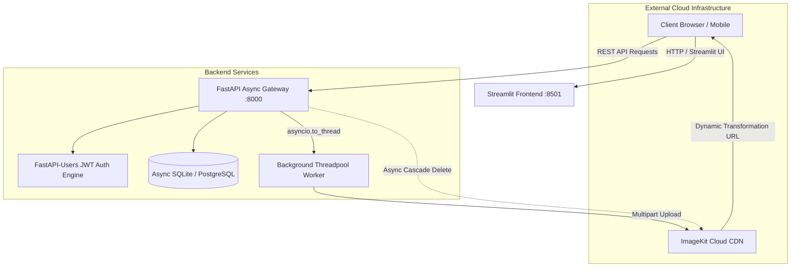

# ShareThat ✨ — Cloud-Native Asynchronous Media Sharing Platform

[](https://www.python.org/)
[](https://fastapi.tiangolo.com/)
[](https://streamlit.io/)
[](https://www.docker.com/)
[](https://docs.pytest.org/)
[](LICENSE)

**ShareThat** is a high-performance, full-stack media sharing application engineered to handle non-blocking media ingestion, real-time CDN transformation pipelines, stateless JWT authentication, and automated cloud asset lifecycle management.

Designed from the ground up for high concurrency, ShareThat offloads blocking CPU and network I/O to background thread pools to ensure uninterrupted low-latency request handling for community feeds.

---

## 🏛️ System Architecture



---

## ✨ Key Architectural Features

- **🧵 Non-Blocking Async Ingestion**: Heavy media upload payloads are offloaded from FastAPI's event loop to dedicated worker threads using `asyncio.to_thread()`, keeping the main async loop responsive to concurrent API queries.
- **🖼️ Real-Time Dynamic CDN Pipelines**: Automatic aspect-ratio preservation, video blurred padding, and dynamic caption text overlays via URL-based transformation parameters.
- **🔐 Robust Stateless JWT Authentication**: Bearer-token authentication powered by `fastapi-users` with cryptographically secure Argon2 password hashing.
- **🧹 Cascade Asset Lifecycle Management**: Deleting a post automatically triggers an asynchronous cleanup of the remote asset on the CDN, preventing orphaned storage costs.
- **🛡️ Dev-Resilient Fallback Provider**: Includes a resilient mock CDN fallback mode, allowing local development and testing to run seamlessly even without active cloud provider credentials.
- **🐳 Containerized Multi-Service Orchestration**: Fully reproducible Docker and `docker-compose` configuration for zero-friction deployment.
- **🧪 100% Automated Test Suite**: Async integration test suite built with `pytest-asyncio` and `httpx.AsyncClient` covering auth, feed retrieval, ownership permissions, and post lifecycles.

---

## 🛠️ Tech Stack

| Domain | Technology | Purpose |
| :--- | :--- | :--- |
| **Backend Framework** | [FastAPI](https://fastapi.tiangolo.com/) | High-performance asynchronous REST API gateway |
| **Database ORM** | [SQLAlchemy 2.0 (Async)](https://www.sqlalchemy.org/) + [aiosqlite](https://github.com/omnilib/aiosqlite) | Fully async relational database layer |
| **Authentication** | [FastAPI-Users](https://fastapi-users.github.io/fastapi-users/) | Stateless JWT bearer tokens with UUID identity mapping |
| **Media CDN** | [ImageKit.io SDK](https://imagekit.io/) | Cloud media storage and real-time URL transformation engine |
| **Frontend UI** | [Streamlit](https://streamlit.io/) | Reactive web dashboard with custom glassmorphic styling |
| **Testing** | [Pytest](https://pytest.org/) + [pytest-asyncio](https://github.com/pytest-dev/pytest-asyncio) + [HTTPX](https://www.python-httpx.org/) | Async API test suite |
| **DevOps** | [Docker](https://www.docker.com/) + [Docker Compose](https://docs.docker.com/compose/) | Containerization and multi-service orchestration |

---

## 🚀 Quickstart Guide

### 1. Prerequisites
- Python 3.13+
- Virtual environment manager (`venv` or `uv`)
- Docker & Docker Compose (optional for containerized run)

### 2. Environment Configuration
Copy the template configuration file:
```bash
cp .env.example .env
```
*(Optional)* Add your ImageKit credentials in `.env`. If left empty, ShareThat will automatically operate in resilient local development mode.

### 3. Local Installation
```bash
# Create and activate virtual environment
python -m venv .venv
source .venv/bin/activate  # On Windows: .\.venv\Scripts\activate

# Install dependencies
pip install -r requirements.txt
```

### 4. Running the Application

**Option A: Running Locally with Uvicorn & Streamlit**

Start the FastAPI backend:
```bash
uvicorn app.app:app --host 127.0.0.1 --port 8000 --reload
```

In a separate terminal, launch the Streamlit frontend:
```bash
streamlit run frontend.py --server.port 8501
```

Access the application:
- **Interactive Web App**: [http://localhost:8501](http://localhost:8501)
- **Interactive Swagger API Docs**: [http://localhost:8000/docs](http://localhost:8000/docs)
- **ReDoc Documentation**: [http://localhost:8000/redoc](http://localhost:8000/redoc)

**Option B: Running with Docker Compose**
```bash
docker-compose up --build
```

---

## 📡 API Specification

| Method | Endpoint | Description | Auth Required |
| :--- | :--- | :--- | :---: |
| `POST` | `/auth/register` | Register a new user account | ❌ |
| `POST` | `/auth/jwt/login` | Authenticate and obtain JWT Bearer Token | ❌ |
| `GET` | `/users/me` | Retrieve profile of currently authenticated user | ✅ |
| `GET` | `/feed` | Retrieve all community posts with ownership tags | ✅ |
| `POST` | `/upload` | Upload an image/video with caption to cloud CDN | ✅ |
| `DELETE` | `/posts/{post_id}` | Cascade delete a post and its remote cloud asset | ✅ |

---

## 🧪 Testing

### Automated Pytest Suite
Run the full async test suite verifying registration, token generation, ownership guards, and feed pipelines:
```bash
pytest test_app.py -v
```

### End-to-End Live Workflow Verification
Execute the automated live workflow script against running servers:
```bash
python e2e_verify.py
```

---

## 📂 Project Structure

```text
sharethat/
├── app/
│   ├── app.py             # FastAPI entrypoint, lifespan & REST routes
│   ├── db.py              # Async database engine, models (User, Post) & session
│   ├── images.py          # ImageKit CDN SDK client initialization
│   ├── schemas.py         # Pydantic validation schemas
│   └── users.py           # FastAPI-Users JWT authentication configuration
├── Dockerfile             # Multi-stage container definition
├── docker-compose.yml     # Multi-container orchestration (API + UI)
├── frontend.py            # Streamlit reactive UI with custom styling
├── test_app.py            # Pytest async test suite (HTTPX AsyncClient)
├── e2e_verify.py          # Live end-to-end integration test script
├── pyproject.toml         # Project metadata and dependencies
├── requirements.txt       # Production dependencies
├── .env.example           # Environment template
└── README.md              # Project documentation
```

---

## 📄 License
This project is licensed under the MIT License — see the [LICENSE](LICENSE) file for details.
